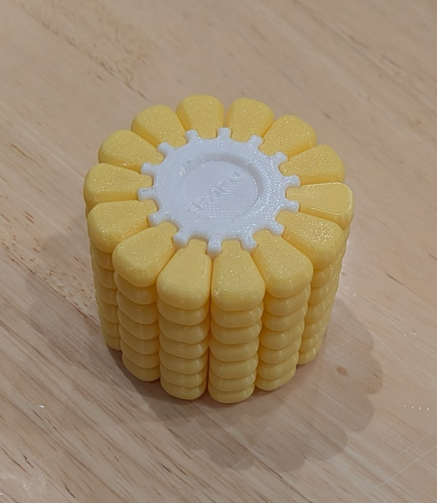
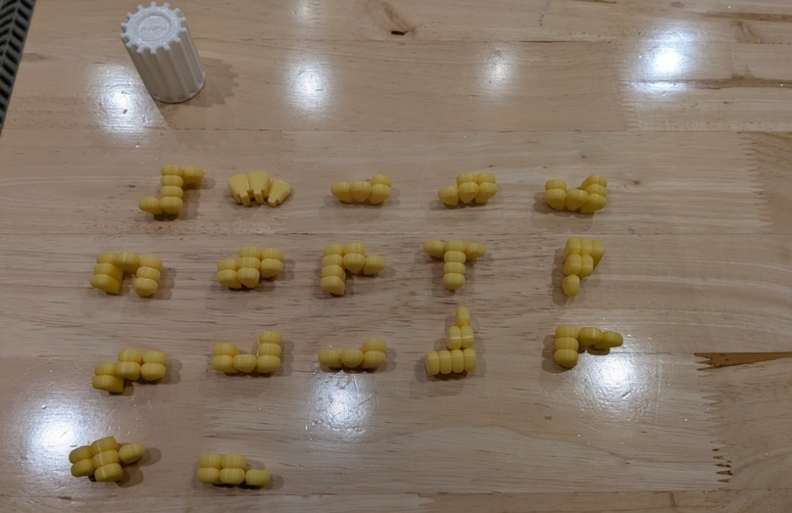
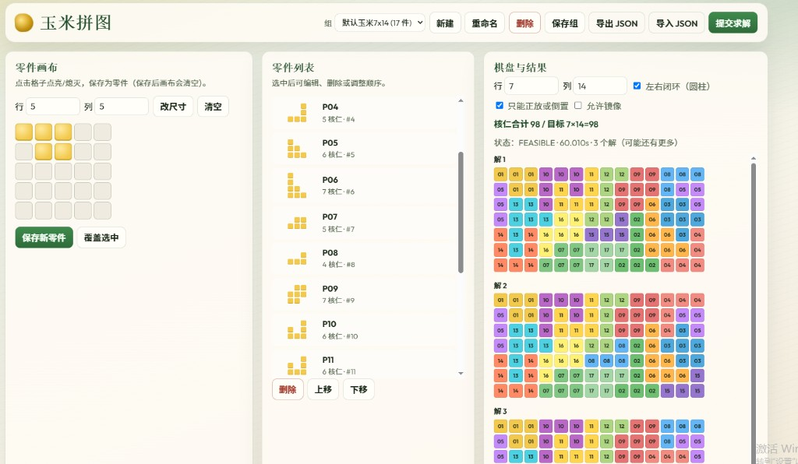

# 玉米拼图网页编辑器

一个本地运行的玉米拼图建模与求解工具。可在浏览器中绘制多连骨牌零件，并使用 Google OR-Tools CP-SAT 求解圆柱网格上的精确覆盖问题。

项目自带一组实物录入的 **7×14、17 件、共 98 格**示例数据。左右两列可闭环，适合模拟圆柱形玉米拼图。

## 实物参考

拼好的玉米，白芯为 7×14 圆柱网格：



拆开的 17 个黄块零件和白芯：



## 求解结果

用默认组、7×14、左右闭环，并限制为「只能正放或倒置、不允许镜像」求解。60 秒时限内找到 3 个不同展开图；状态为 `FEASIBLE`，搜索尚未穷尽，所以还可能有更多解。相同零件对换和整图左右平移已经合并，不会重复列出。



## 功能

- 可配置棋盘行列数和左右闭环
- 在可调尺寸画布上绘制、覆盖和删除零件
- 多组数据的本地 JSON 持久化及导入、导出
- 默认仅允许零件正放或旋转 180°，可选择允许横放
- 默认禁止镜像，可单独选择允许镜像
- 枚举并展示多个解，自动合并：
  - 相同零件互换产生的重复解
  - 圆柱棋盘整体左右平移产生的重复解
- 核仁总数检查和无解诊断
- 可在局域网内共享使用，无账号、无云端依赖

## 技术栈

- Python 3.10+
- FastAPI / Uvicorn
- Google OR-Tools CP-SAT
- 原生 HTML、CSS、JavaScript

## 安装与启动

克隆项目后进入项目目录：

```bash
python -m pip install -r requirements.txt
python -m uvicorn backend.main:app --host 127.0.0.1 --port 8000
```

浏览器打开 <http://127.0.0.1:8000>。

### 局域网访问

改为监听所有网卡：

```bash
python -m uvicorn backend.main:app --host 0.0.0.0 --port 8000
```

同一局域网的设备可通过 `http://<运行电脑的局域网IP>:8000` 访问。必要时请在防火墙中放行 8000 端口。

### Docker

```bash
docker build -t corn-puzzle-editor .
docker run --rm -p 8000:8000 corn-puzzle-editor
```

## 使用方法

1. 选择现有组或新建一组。
2. 在左侧画布点亮格子，保存新零件或覆盖选中的零件。
3. 设置棋盘尺寸、闭环方式及零件方向约束。
4. 确认零件格数总和等于 `行数 × 列数`。
5. 点击「提交求解」查看结果或诊断信息。
6. 点击「保存组」将当前数据写入 `data/sets/`。

保存新零件只更新当前页面中的组；要永久写入磁盘，还需点击「保存组」。

## 数据

预置示例位于 `data/sets/default-corn-7x14.json`。

网页中新建的其他数据组也会保存在 `data/sets/`，但默认被 `.gitignore` 排除，避免意外提交个人数据。需要分享时可从网页导出 JSON，或调整忽略规则。

## API

| 方法 | 路径 | 说明 |
| --- | --- | --- |
| `GET` | `/api/health` | 健康检查 |
| `GET` / `POST` | `/api/sets` | 列出或新建组 |
| `GET` / `PUT` / `DELETE` | `/api/sets/{id}` | 读取、更新或删除组 |
| `POST` | `/api/solve` | 求解当前组快照 |

## 测试

```bash
python -m pytest tests/test_solver.py -v
```

## 说明

求解思路参考 Patrick Thill 的文章 *Solving a corn puzzle with CP-SAT*。本项目默认在本地运行，不包含账号体系，也不会自动上传数据。
